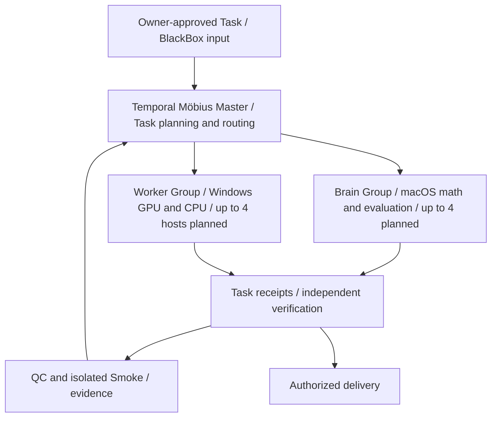

# HAVEFUN Q-Framework | Multi-Node Compute Roadmap

**Public design note · 2026-10-26 · BlackBox-safe · English / 繁中**

## System boundary

The planned Temporal Möbius network coordinates **distinct hardware** rather than pretending independent VRAM pools form a single physical GPU. The future target is **four macOS Brain devices and four Windows Worker hosts**. This is a target node count, **not** eight GPUs and not a claim that all eight already execute the same H3 native inference job.

**已驗證：**單卡 RTX 2080 Ti 22GB 完成 1080×1920／5 秒／120 幀 H3；#361 四張 RTX 2080 Ti 已完成分段 480p／15 秒影片；另有受控跨裝置數學、計算狀態完整性與有限訓練實驗。這些**不能直接等同於**四 Mac＋四 Windows 的八機全鏈影音運算已完成。

## Public conceptual topology

This is a **conceptual public diagram**, not a literal network wiring, authenticated endpoint list or internal algorithm. Raw prompts, private media, node addresses, runtime graphs, keys and state encodings remain Owner-only.

## Progressive acceptance gates

| Gate | Must demonstrate | Evidence class |
|---|---|---|
| P0: Foundations | Completed native single-GPU H3 1080p-class film; completed four-GPU #361; bounded numerical state/integrity comparisons | **Verified only for specified workloads** |
| P1: One-Worker complete round trip | Compatible identity, task claim, actual compute, submit, authenticated result receipt, heartbeat, retry correctness | **In integration/validation** |
| P2: Eight-device coordination | Four Brain plus four Windows Worker hosts with observable scheduling, load isolation, recovery and idempotency | **Future acceptance target** |
| P3: Learning → isolated smoke → scoring | New learning triggers synthetic isolated smoke; output, speed and consistency checked by Master and Möbius; owner-private samples remain invisible | **Research target** |
| P4: Public repeatability | Sanitized signed evidence summaries for success rate, workload dimensions, compute time, recovery count, node contribution, OOM and quality checks | **Not yet published as completed** |

## Operating principles

- **Result first:** distinguish `FAILED / OOM / RUNNING / COMPLETED / OWNER_QC_PENDING`; running without native receipt is not a success.
- **Per-node accountability:** a task receipt links authorized work, node type, completion and verification without exposing private content.
- **State and resource isolation:** worker memory is local; CPU+GPU scheduling and state movement must be proven in bounded experiments, not assumed to create unified VRAM.
- **Owner control:** approval of participating devices, pause, cancellation, rollback and publication of evidence are Owner-controlled. No automatic onboarding of unrelated or unauthorized devices.
- **Q family BlackBox:** QmRNA, QVRAM, QSTATIC, QAnswer and Temporal Möbius are documented by *functions and tested outcomes*, not proprietary algorithms or full runtime controls.
- **Performance science:** measure completion, correctness, time and reliability separately; avoid comparing workloads with different models, resolutions and segment counts as though they were the same benchmark.

## Public visual

[Interactive-readable architecture page](../site/multi-node.html) · [Screenshot](../assets/multi-node-plan.png) · [Whitepaper (繁中)](../whitepaper/Q-Framework-v1.0-RC4.3-ZH-TW.md) · [Disclosure boundary](blackbox-disclosure-policy.md)

