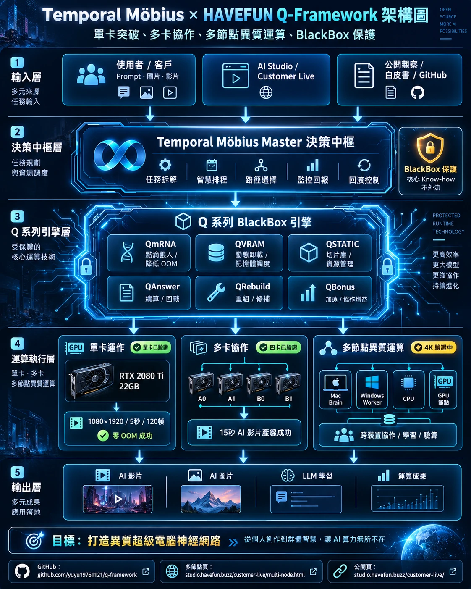
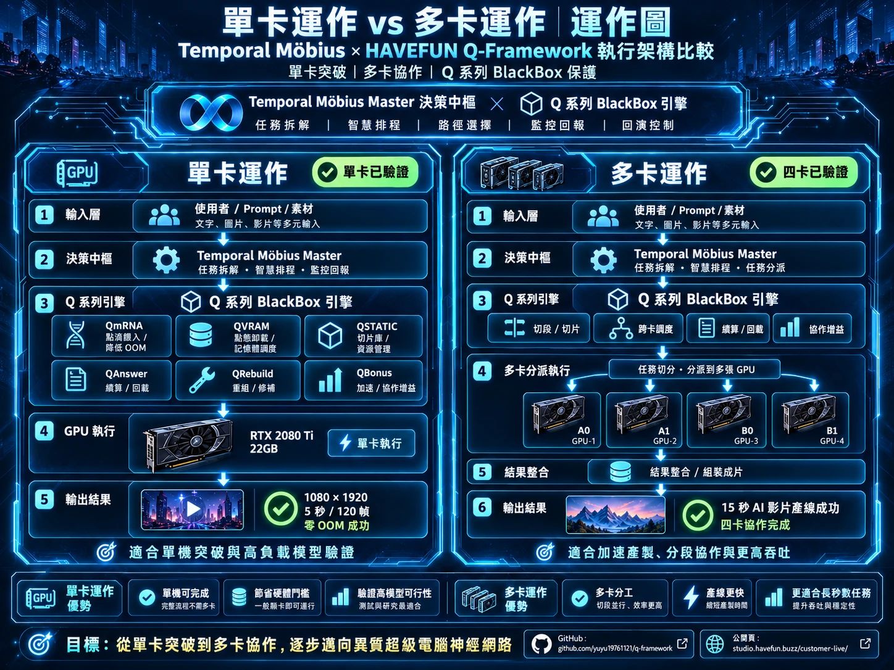
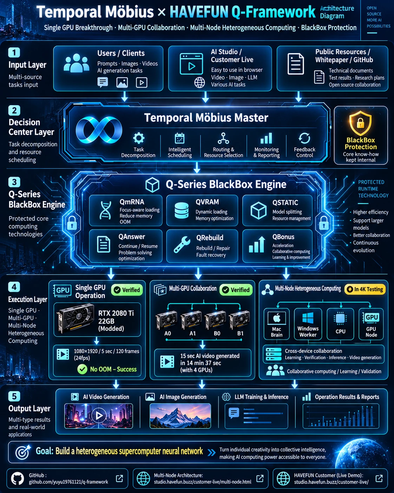
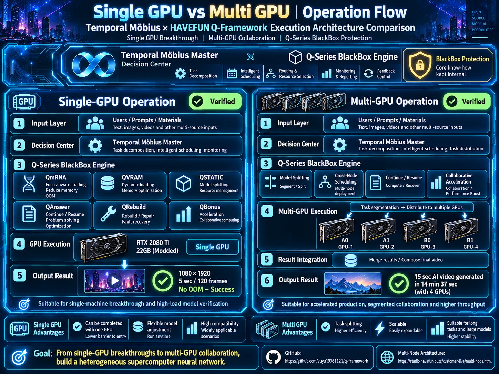
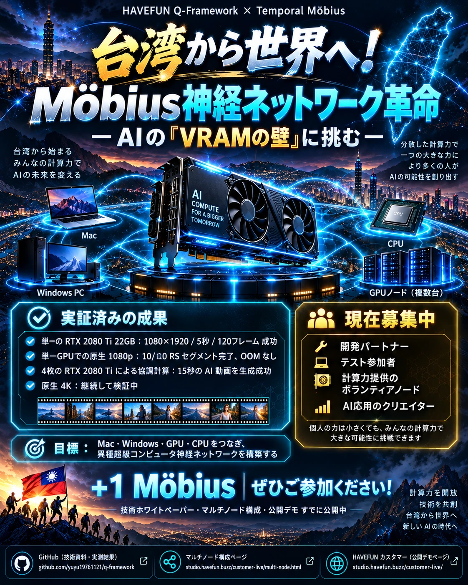
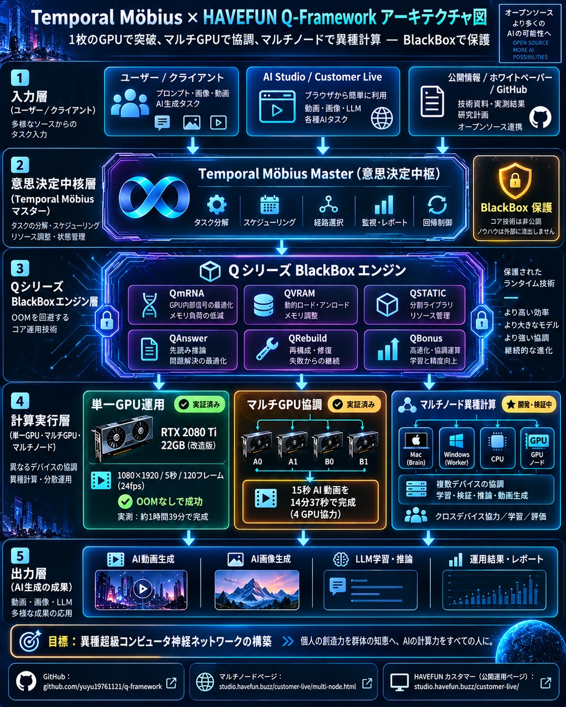
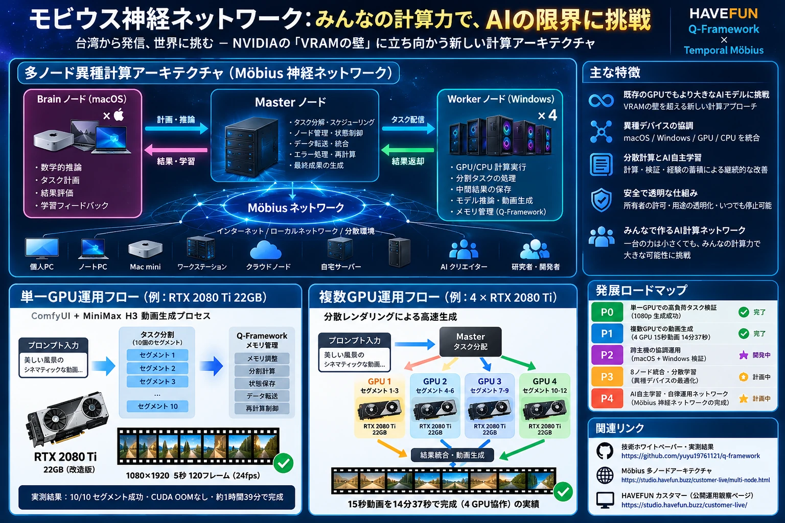

# HAVEFUN Q-Framework × Temporal Möbius | Public Visual Gallery

**Nine public promotional and explanatory visuals · 繁體中文 / English / 日本語**

All nine images below were created for the public Möbius recruitment and research explanation campaign and are shared with the owner's request. These are **illustrative designs**, not raw runtime screenshots, output-frame samples, or evidence that a planned capability has already been implemented.

| Language / 語言 | Recruitment poster / 招募海報 | Framework architecture / 系統架構 | Single vs multi-GPU / 單卡與多卡 |
|---|---|---|---|
| **繁體中文** |  |  |  |
| **English** |  |  |  |
| **日本語** |  |  |  |

## Share and review / 分享與檢視 / 共有

- **Verified within stated test conditions / 已驗證：**one memory-expanded RTX 2080 Ti 22GB completed a segmented 1080×1920, five-second film with 10/10 native RS; no CUDA OOM was recorded *in that run*. Four separate RTX 2080 Ti GPUs also completed a bounded 15-second film in a 14m37s production workflow.
- **Under test / 驗證中：**native 4K on one GPU. These pictures must not be interpreted as confirmation that a 4K MP4 has been delivered.
- **Roadmap / 計劃：**the eight-device heterogeneous target (four macOS Brain + four Windows Worker hosts) is not a finished universal eight-node H3 demonstration.
- **BlackBox / 保護：**no actual customer images, private prompts, internal IPs, source code or runtime keys are included. The diagrams are conceptual.

See the [Public claim ledger](claim-ledger.md), [three-language whitepaper](../README.md), [multi-node plan](multi-node-roadmap.md), [public architecture page](../site/multi-node.html), and [customer viewing page](https://studio.havefun.buzz/customer-live/).

**Files:** optimized high-quality WebP images, original aspect ratio and resolution preserved for efficient GitHub viewing. The local source PNGs are maintained separately.

